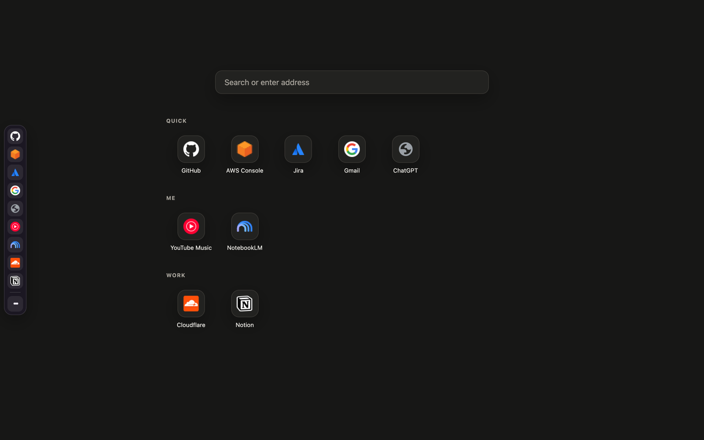
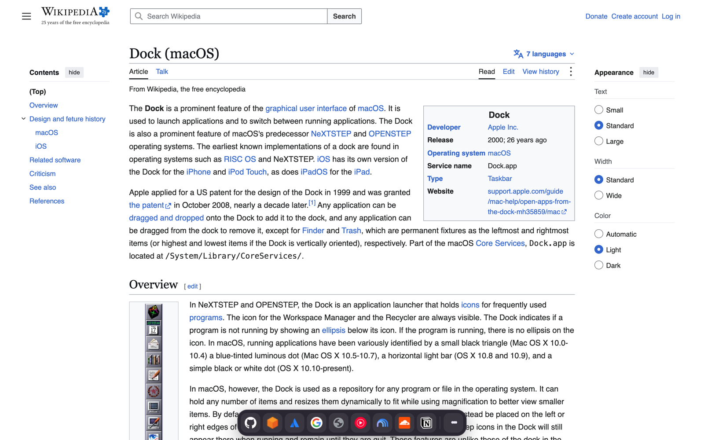
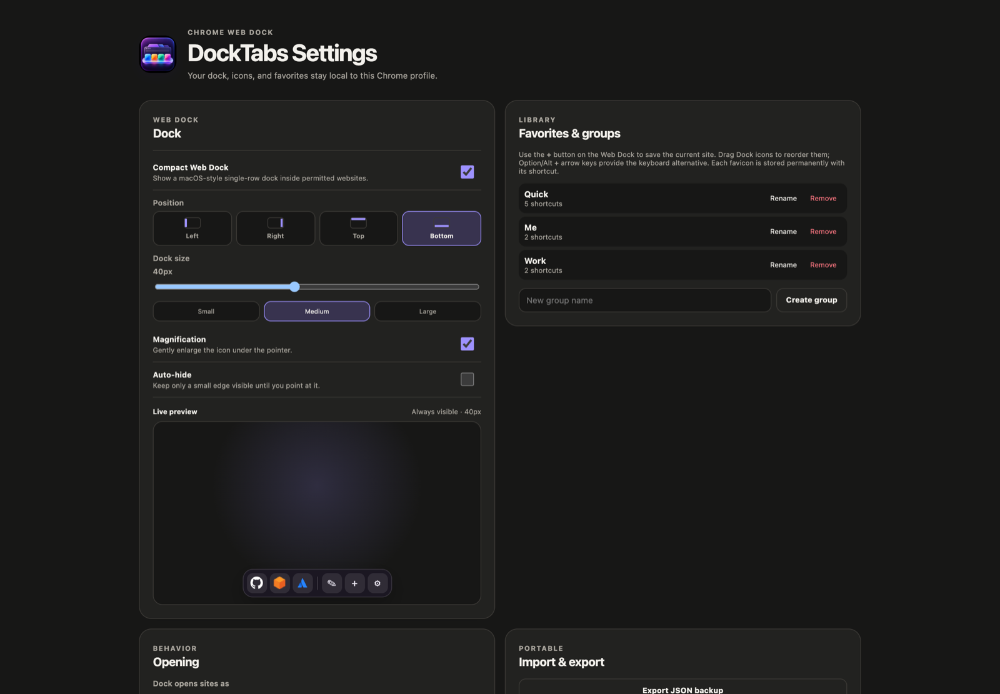

# DockTabs

A macOS-style dock for Chrome. DockTabs keeps your favorite sites in a persistent, configurable Web Dock on the edge of every web page and on its own new tab page. Sites opened from the Dock behave like apps: open them once, then return to them from the Dock instead of hunting through tabs.

DockTabs is a local-only Manifest V3 extension. It has no server, telemetry, or remote code.



## Features

- **Web Dock on every site.** A single-row dock on the left, right, top, or bottom edge of regular `http/https` pages, with magnification, auto-hide, and drag-to-reorder.
- **App-like opening.** Choose how the Dock opens sites: as **pinned tabs** (default), as **app windows** without a tab strip, or as regular tabs. Clicking a Dock icon again returns to the site that is already open instead of opening a duplicate.
- **New tab launcher.** The new tab page shows a search box, an always-visible Dock, and a Launchpad-style grid of your favorites grouped like the Dock. The empty new tab closes itself after it launches a site.
- **Groups and backups.** Organize shortcuts into groups, export and import JSON backups, and import Vivaldi bookmarks.



## Installation

### Install the ready-made package (no build required)

1. Download `docktabs-v<version>.zip` from the [latest release](https://github.com/mehmetbltt23/Chrome-dock-extensions/releases/latest) and unzip it.
2. Open `chrome://extensions` and turn on **Developer mode** (top right).
3. Click **Load unpacked** and select the unzipped folder. Keep the folder where it is; Chrome loads the extension from it.
4. When Chrome asks whether to keep the changed new tab page, choose **Keep changes**.

Chrome installs extensions without Developer mode only from the Chrome Web Store. The same zip file is the package to upload there.

### Build from source

Requirements: Chrome 114 or newer, Node.js 24.14.1 or newer, and npm 11.11.0 or newer.

```bash
npm ci
npm run build
```

Then load the project's `dist/` folder with **Load unpacked** as above. `npm run package` builds and zips `dist/` into `docktabs-v<version>.zip` for a release or a Chrome Web Store upload.

The DockTabs toolbar icon opens Settings. The default shortcut is `Command+Shift+D` on macOS and `Ctrl+Shift+D` elsewhere; change it at `chrome://extensions/shortcuts`.

## Usage

1. In Settings, turn on **Compact Web Dock** and approve website access.
2. Pick the Dock position (left, right, top, or bottom) and an icon size between 28 and 56 px.
3. Open the Dock's `•••` menu and press `+` to add the current page. Each site's favicon is stored with its shortcut in `chrome.storage.local`, so it survives tab, service-worker, and Chrome restarts.
4. Drag icons along the Dock to reorder them, or drag an icon onto the **Remove** target to delete it. Keyboard alternatives: `Option/Alt + arrow keys` moves the focused icon and `Option/Alt + Backspace` removes it.
5. Under **Opening → Dock opens sites as**, choose **Pinned tab**, **App window**, or **Tab**.



### Opening modes

| Mode | First click | Later clicks |
|---|---|---|
| **Pinned tab** (default) | Opens the site as a compact pinned tab in the last used Chrome window. | Switches to that tab, pinning a matching tab that was not pinned yet. |
| **App window** | Opens the site in its own window without a tab strip, sized like your last window. | Brings that window forward, restoring it if minimized, until you close it. |
| **Tab** | Opens the site as a regular tab. | Switches to a matching tab when **Reuse matching tabs** is on. |

## Import and backup

Vivaldi bookmarks can be imported from their exported HTML file. Folders become groups, only safe `http/https` entries are accepted, and the file is processed locally.

**Export JSON backup** downloads all versioned data. **Import JSON backup** shows a summary first and replaces the current data only after you confirm. Import files are limited to 5 MB.

## Permissions and security

- `tabs`: find, activate, and pin the tab that matches a shortcut.
- `storage`: keep shortcuts, stored favicons, groups, and preferences in the local Chrome profile, and track open app windows for the current browser session.
- `favicon`: read site icons from Chrome's local `_favicon` resource.
- `scripting`: inject the packaged Web Dock into permitted web pages.
- `search`: send text typed into the new tab search box to your default search engine. Chrome shows no install warning for it.

Access to `http://*/*` and `https://*/*` is optional. It is requested only when you turn on the Web Dock and is removed when you turn it off. DockTabs has no `cookies`, `history`, `webRequest`, or required host permission, and no telemetry, ads, remote code, or application server. See the [security notes](docs/SECURITY.md) for details.

## Development

```bash
npm run validate
npm run typecheck
npm run lint
npm test
npm run build
```

Build validation checks that `dist/` contains only the required Manifest V3 entries and the packaged new tab page, has no side panel, keeps the Web Dock script self-contained, and has no dynamic code execution in the service worker.

## Chrome limitations

- An extension cannot hide or change Chrome's built-in tab strip. Pinned tabs and app windows are the closest supported ways to keep sites out of the way.
- Chrome does not allow content scripts on its own new tab page, so DockTabs replaces it with `newtab.html`. Address-like input in its search box opens directly; anything else is searched with your default search engine. Because the override is declared in the manifest, Google's new tab page cannot be switched back from Settings.
- Other `chrome://` pages, the Chrome Web Store, and Chrome's network and certificate error pages are protected, so the Dock cannot appear there. Server-rendered HTTP 404/500 pages on permitted origins do show it.
- The Dock starts at `document_start`, before page resources load. A full-page navigation removes it with the old document and rebuilds it for the new one; this short gap cannot be avoided with an in-page dock.
- App windows are tracked in `chrome.storage.session`, which Chrome clears when it quits. App windows that Chrome restores are adopted again by URL on the first Dock click.
- Links that an app window opens in a new tab (`target=_blank`) open in a regular Chrome window, as Chrome requires.
